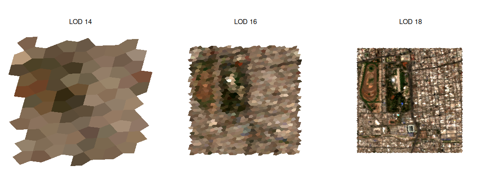

# a5pyramid

a5pyramid builds level-of-detail pyramids of [A5](https://a5geo.org/)
cells and writes them, with the cells they summarise, to one Parquet
file laid out for the browser. A web map reads the file’s footer, picks
the level for its zoom and fetches only the tiles in view with HTTP
range requests, for example with
[hyparquet](https://github.com/hyparam/hyparquet) and deck.gl. No tile
server and no pre-cut tile directory are needed: one static file serves
every zoom.

It takes cells from [a5R](https://github.com/belian-earth/a5R) and
[a5px](https://github.com/belian-earth/a5px), and replaces the pyramid
builder in [a5view](https://github.com/belian-earth/a5view). The engine
is a Rust crate with no R dependency, in `src/rust/a5pyramid`, to be
published on its own.

|  |  |
|----|----|
| Build | [`a5_pyramid()`](https://belian-earth.github.io/a5pyramid/reference/a5_pyramid.md) builds the levels as a tibble; [`a5_write_pyramid()`](https://belian-earth.github.io/a5pyramid/reference/a5_write_pyramid.md) builds and writes them to Parquet in Rust, in parallel; [`a5_pyramid_arrow()`](https://belian-earth.github.io/a5pyramid/reference/a5_pyramid_arrow.md) returns the same tiles in memory as an Arrow table, without a file |
| Reduce | mean, sum, min, max, mode, or a representative leaf that keeps real combinations of values such as colours |
| Read | [`a5_pyramid_info()`](https://belian-earth.github.io/a5pyramid/reference/a5_pyramid_info.md) reads the index from the footer; [`a5_read_pyramid()`](https://belian-earth.github.io/a5pyramid/reference/a5_read_pyramid.md) reads levels within a bounding box, as a renderer does |
| Format | One tile per Parquet row group (or Arrow record batch), with each tile’s level and bounding box indexed in the metadata; specified in [`FORMAT.md`](https://belian-earth.github.io/a5pyramid/src/rust/a5pyramid/FORMAT.md) |

## Installation

a5pyramid is not on CRAN. Install the development version from GitHub:

``` r

# install.packages("pak")
pak::pak("belian-earth/a5pyramid")
```

Building from source needs a [Rust toolchain](https://rustup.rs/) with
`rustc` 1.88 or later.

## Example

`s2_santiago`, from a5view, holds 15,626 resolution-18 cells (about 22 m
across) of a cloud-free Sentinel-2 mosaic over Santiago, Chile, with the
blue, green, red and near-infrared bands. This writes a pyramid of it
with a representative leaf for the bands, so a coarse cell keeps the
colour of a real pixel rather than a blend, and the mean NDVI.

``` r

library(a5pyramid)

santiago <- a5view::s2_santiago
santiago$ndvi <- with(santiago, (B08 - B04) / (B08 + B04))

path <- tempfile(fileext = ".parquet")
a5_write_pyramid(
  santiago, path,
  aggregate = "rep_child",
  reducers = c(ndvi = "mean"),
  types = c(B02 = "uint16", B03 = "uint16", B04 = "uint16", B08 = "uint16", ndvi = "float32")
)
```

``` r

a5_pyramid_info(path)
#> ── a5pyramid file 'file2b25b31ec7da4.parquet' ──────────────────────────────────
#> Size: 380.2 KB (footer 10.7 KB)
#> A5 index: 1.0
#> Leaves: resolution 18, 15,626 cells
#> LODs: 2-18 (17 levels)
#> Rows: 21,077
#> Tiles: 22 row groups (tile size 4096)
#> Columns: B02 <uint16, rep_child>, B03 <uint16, rep_child>, B04 <uint16,
#> rep_child>, B08 <uint16, rep_child>, ndvi <float32, mean>
#> Bbox: -70.6722, -33.4801, -70.6418, -33.4549
#> Written by: a5pyramid 0.0.0.9000, a5 crate 1.0.0
```

Every coarser level groups the leaves by the cell containing their
centres, so each level partitions the data and `ncell` counts the leaves
under each cell. A browser opening the file reads the footer only, here
a few kilobytes, and then the tiles it draws.
[`a5_read_pyramid()`](https://belian-earth.github.io/a5pyramid/reference/a5_read_pyramid.md)
reads levels the same way:

``` r

library(ggplot2)

levels <- a5_read_pyramid(path, lod = c(14, 16, 18))
ggplot(levels, aes(cell = cell, fill = a5view::cells_rgb(B04, B03, B02, range = c(300, 2800)))) +
  a5view::geom_a5() +
  facet_wrap(~ paste("LOD", lod)) +
  theme_void()
```



## How it works

**Levels.** A cell at LOD `r` summarises the leaves whose centres it
contains
([`a5R::a5_cell_to_supercell()`](https://belian-earth.github.io/a5R/reference/a5_spatial_hierarchy.html)).
Supercells do not chain: a leaf’s supercell two resolutions up is often
not the supercell of its supercell one resolution up, so every level is
grouped from the leaves directly.

**Tiles.** Each level is split into tiles of at most `tile_size` rows,
one Parquet row group each. A tile is a run of consecutive cell ids, and
A5 ids follow a space-filling curve, so a run is a compact patch of the
globe. Levels are split down the A5 hierarchy only where a run holds
more cells than fit a tile, so tiles are coarse where data is sparse and
fine where it is dense, and every level stays sorted by cell id.

**Index.** The file’s key-value metadata holds a JSON index of the
levels, the value columns, and the bounding box of every tile, computed
from the cells’ boundaries (antimeridian and poles included). Cell ids
are delta encoded, which takes them from 8 bytes per row to about 3, and
Snappy compression keeps the file readable by hyparquet with no extra
libraries. The test suite reads files with hyparquet under Node and
checks that only the footer and the requested tile are fetched.

## Performance

Writing a pyramid of 439,276 resolution-16 cells over central Scotland,
with four `uint8` colour channels and a `float32` value, as a5view
prepares them (`benchmarks/bench-vs-a5view.R`, 20 threads):

|           | a5view 0.3 | a5pyramid |
|-----------|------------|-----------|
| mean      | 4.06 s     | 0.48 s    |
| rep_child | 4.06 s     | 0.49 s    |
| file size | 9.0 MB     | 6.5 MB    |

Both spend most of their single-threaded time in the a5 crate’s
supercell lookup; a5pyramid gains by running it in parallel and by
building the levels and the file without R in between. Results do not
depend on the number of threads, which
[`a5pyramid_threads()`](https://belian-earth.github.io/a5pyramid/reference/a5pyramid_threads.md)
sets.
